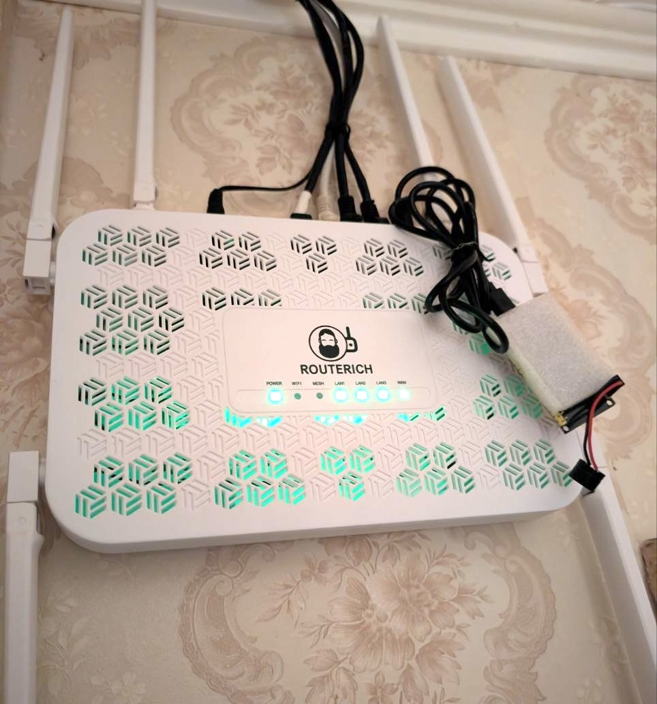

# sketch_tuya

Прошивка для ESP32: Telegram-бот принимает команды и передаёт их в Tuya Cloud API. Позволяет включать и выключать устройство, запускать таймер обратного отсчёта и получать диагностику по Wi-Fi и API. Звуковые подтверждения выводятся на пьезоизлучатель.



## Возможности

- Управление устройством Tuya через команды Telegram (`switch_1`).
- Белый список Telegram user ID: остальным доступ запрещён.
- Таймер на 5, 10, 15 минут или произвольное значение. Устройство включается сразу и выключается по истечении времени.
- Команда остатка времени и ручной сброс таймера.
- Диагностика: уровень Wi-Fi, доступность Tuya API, текущее время UTC.
- Список устройств задаётся в коде, активное устройство переключается командой.
- Звуковые сигналы при старте, включении и выключении.

## Требования

Оборудование:

- ESP32 (подойдёт любая плата с Wi-Fi).
- Пьезоизлучатель, подключённый к GPIO 23. Не обязателен: если его нет, уберите вызовы `tone()` или оставьте пин неподключённым.

Программное обеспечение:

- Arduino IDE 2.x.
- Пакет плат ESP32 от Espressif (устанавливается через Boards Manager).
- Библиотеки (Library Manager):
  - UniversalTelegramBot (Brian Lough);
  - ArduinoJson 6.x. Версия важна: код использует `StaticJsonDocument`, которого нет в ArduinoJson 7.

`WiFiClientSecure`, `mbedtls` и `time.h` входят в пакет ESP32 и отдельно устанавливать не нужно.

## Настройка

Все параметры находятся в начале файла `sketch_tuya.ino`, в блоке `НАСТРОЙКИ`.

| Параметр | Значение |
|---|---|
| `ssid`, `password` | Данные Wi-Fi сети 2.4 ГГц. ESP32 не поддерживает сети 5 ГГц. |
| `BOT_TOKEN` | Токен бота, полученный у [@BotFather](https://t.me/BotFather). |
| `ALLOWED_ID_1`, `ALLOWED_ID_2` | Числовые Telegram ID пользователей, которым разрешено управление. |
| `TUYA_CLIENT_ID` | Access ID проекта Tuya IoT Platform. |
| `TUYA_SECRET` | Access Secret проекта Tuya IoT Platform. |
| `TUYA_HOST` | Data center проекта: `openapi.tuyaeu.com` (Европа), `openapi.tuyaus.com` (Америка), `openapi.tuyacn.com` (Китай), `openapi.tuyain.com` (Индия). |
| `myDevices[]` | Массив устройств: отображаемое имя и `device_id` из Tuya. |
| `BUZZER_PIN` | Пин пьезоизлучателя, по умолчанию 23. |

### Telegram ID

Свой ID можно узнать у бота `@userinfobot` или `@getidsbot`. Это число, не username.

### Доступ к Tuya Cloud API

1. Зарегистрируйтесь на [iot.tuya.com](https://iot.tuya.com) и создайте Cloud-проект в нужном data center.
2. В разделе Devices подключите аккаунт приложения Tuya (Link Tuya App Account) и выберите устройства.
3. В Project Overview скопируйте Access ID и Access Secret — это `TUYA_CLIENT_ID` и `TUYA_SECRET`.
4. В списке устройств скопируйте Device ID нужного устройства и укажите его в `myDevices`.
5. Убедитесь, что для проекта включены API управления устройствами (IoT Core / Device Control).

Код отправляет команду `switch_1`. Для одноклавишного реле или розетки этого достаточно. Для других устройств код DP может отличаться: например, у лампы это обычно `switch_led`. Проверить список DP можно в разделе устройства на iot.tuya.com.

## Установка

1. Установите Arduino IDE и добавьте поддержку ESP32: Файл → Настройки → Дополнительные ссылки для менеджера плат, затем в Boards Manager установите пакет `esp32`.
2. Установите библиотеки `UniversalTelegramBot` и `ArduinoJson` (6.x) через Library Manager.
3. Скопируйте папку проекта: имя папки должно совпадать с именем файла скетча (`sketch_tuya` / `sketch_tuya.ino`), иначе Arduino IDE не откроет скетч корректно.
4. Откройте `sketch_tuya.ino` и заполните блок `НАСТРОЙКИ`.
5. Выберите плату (например, ESP32 Dev Module) и порт.
6. Прошейте плату.
7. Откройте Serial Monitor на скорости 115200.

При успешном старте в логе будут строки о подключении Wi-Fi, синхронизации времени и авторизации Tuya, а в Telegram придёт сообщение о запуске бота. Если токен Tuya получить не удалось, в лог выводится ответ API.

## Использование

После запуска отправьте боту `/start`. Команды:

| Команда | Действие |
|---|---|
| `/start` | Список устройств и переход к выбору. |
| `/device1`, `/device2`, ... | Выбрать устройство по номеру. |
| `/on1`, `/on2`, ... | Включить устройство с указанным номером. |
| `/off1`, `/off2`, ... | Выключить устройство и остановить таймер. |
| `/time5`, `/time10`, `/time15` | Включить устройство и запустить таймер на 5, 10 или 15 минут. |
| `/timeset N` | Таймер на N минут (например, `/timeset 30`). |
| `/time` | Показать оставшееся время. |
| `/timereset` | Остановить таймер и выключить устройство. |
| `/ping`, `/status` | Диагностика: Wi-Fi, Tuya API, время UTC. |

Команды `/on` и `/off` с номером одновременно делают устройство активным. Таймер работает с тем устройством, которое было активно в момент запуска.

## Принцип работы

1. При старте плата подключается к Wi-Fi и синхронизирует время по NTP. Корректное время обязательно: подпись запросов Tuya содержит метку времени в миллисекундах.
2. Токен Tuya (`/v1.0/token?grant_type=1`) запрашивается при необходимости и кэшируется до истечения срока действия.
3. Каждый запрос подписывается HMAC-SHA256: `client_id` + токен + метка времени + метод + хеш тела + путь.
4. Команда отправляется методом POST на `/v1.0/iot-03/devices/{device_id}/commands`.
5. Раз в 300 мс бот опрашивает Telegram (`getUpdates`) и обрабатывает новые сообщения.
6. Таймер проверяется в основном цикле. По истечении устройство выключается, владельцу приходит уведомление.

## Ограничения

- Одновременно может работать только один таймер.
- Список устройств и коды DP задаются в коде; добавление устройства требует перепрошивки.
- Для сборки нужна версия ArduinoJson 6.x.
- Плата должна иметь доступ в интернет и корректное время; при сбое NTP запросы к Tuya будут отклонены.
- TLS-соединение создаётся с `setInsecure()`, то есть без проверки сертификата сервера. Для домашнего использования это допустимо, для промышленного — нет.

## Безопасность

В текущей версии Wi-Fi-пароль, токен бота и ключи Tuya хранятся прямо в скетче. Перед публикацией репозитория на GitHub:

- не коммитьте файл с реальными ключами;
- вынесите параметры в отдельный `secrets.h`, добавьте его в `.gitignore`, а в репозиторий положите `secrets.example.h` с заглушками;
- если ключи уже попадали в публичный репозиторий, перевыпустите токен бота через BotFather и Access Secret в Tuya IoT Platform;
- ограничьте доступ белым списком Telegram ID, как сделано в коде.

## Диагностика

| Симптом | Вероятная причина | Что проверить |
|---|---|---|
| В логе `Ошибка получения токена Tuya` | Неверные Client ID/Secret, неправильный data center или рассинхронизация времени | `TUYA_HOST`, ключи проекта, строки времени при старте |
| Ответ API `sign invalid` | Ошибка подписи или неверное время | Синхронизацию NTP, системное время |
| Устройство не реагирует, API отвечает успехом | Неверный код DP | Список DP устройства на iot.tuya.com, поле `code` в `tuyaSendCommand` |
| Бот не отвечает | Нет доступа к Telegram, неверный токен или ID не в белом списке | Serial-лог, `BOT_TOKEN`, `ALLOWED_ID_*` |
| Плата не подключается к Wi-Fi | Сеть 5 ГГц или неверный пароль | Диапазон сети, `ssid` и `password` |
| Команды приходят с задержкой | Опрос раз в 300 мс и сетевая задержка | Нормальное поведение |

## Структура проекта

```
sketch_tuya/
└── sketch_tuya.ino   # весь код прошивки
```
